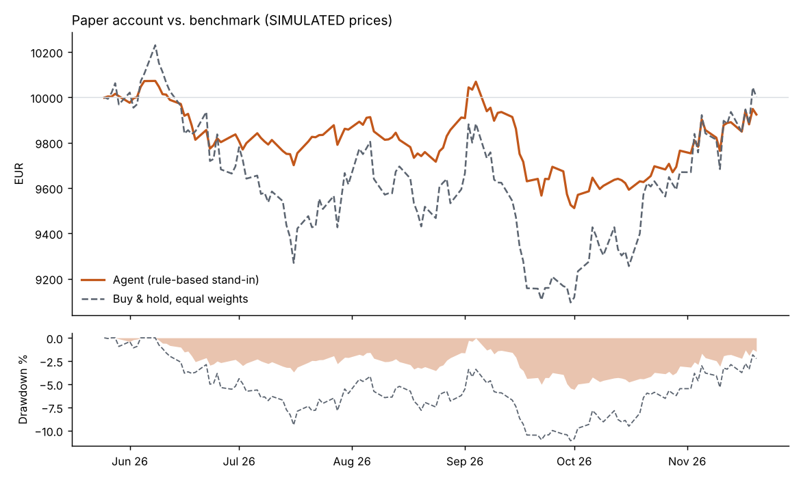

# Trading AI Agent

A research assistant for a **paper-trading account** (simulated money, for learning),
built on Claude and the Model Context Protocol (MCP). Claude can look at prices,
compute indicators, read the portfolio and **propose** trades with a written thesis.
It **cannot execute** them: every order waits for a human to approve it, and hard risk
limits are enforced in code.

> Simulated money only. Indicators describe the past and do not predict the future;
> nothing here is financial advice.



## Project layout

```
Trading_AI_Agent/
├── trading_agent/                 the Python package
│   ├── __main__.py                python -m trading_agent  →  app.main()
│   ├── app.py                     chat with order approval, or --daily report
│   ├── config.py                  paths (data/live, data/sample) and server settings
│   ├── agent/
│   │   └── agent_core.py          reusable MCP agent host: Claude's tool-use loop
│   ├── server/
│   │   └── trading_server.py      MCP server: Claude's tools + host-only tools
│   ├── market/
│   │   ├── market_data.py         prices: simulated (default) or Yahoo (yfinance)
│   │   └── indicators.py          SMA, RSI, changes, volatility, drawdown
│   └── trading/
│       ├── broker.py              paper broker in SQLite
│       └── risk.py                hard risk limits
├── tests/                         pytest suite (uses a temporary data folder)
├── scripts/
│   ├── generate_sample_data.py    6-month replay → data/sample/ (no API key needed)
│   ├── run_daily.sh               daily run for cron (Linux/macOS)
│   └── run_daily.bat              daily run for Task Scheduler (Windows)
├── data/
│   ├── sample/                    example output: prices, orders, equity curve, charts …
│   └── live/                      your own runs: paper.db, reports/ (not in git)
├── pyproject.toml
└── requirements.txt
```

## How it works

```
 you ──chat / commands──▶ app.py ──▶ agent/agent_core.Agent ──▶ Claude (Anthropic API)
                            │                  │  tool calls (MCP, stdio)
                            │ /approve, /reject ▼
                            └──────────▶ server/trading_server.py
                                         ├─ market/market_data.py   prices
                                         ├─ market/indicators.py    SMA, RSI, …
                                         ├─ trading/risk.py         hard limits on every order
                                         └─ trading/broker.py       paper broker → data/live/paper.db
```

**Safety design, in layers:**
1. **Claude only proposes.** `execute_order` and `reject_order` exist on the server, but
   the agent hides them from Claude (`hidden_tools`). Even if Claude guessed a tool name,
   `run_tool` refuses it.
2. **Only you execute.** Orders are executed only by host commands you type
   (`/approve <id>`), which call the server directly, not through Claude.
3. **Risk rules are code, not prompts.** They're checked when an order is proposed and
   again when it's executed, because prices may have moved in between.
4. **Every order has a reason.** A proposal needs a thesis (why + main risk) of at least
   20 characters, and it's stored with the order as a trading journal.
5. **Accounting is all or nothing.** A fill updates cash, position and order status in one
   SQLite transaction.

## Tools

| Tool | Who | What |
|---|---|---|
| `market_overview` | Claude | One line per watchlist symbol: last price, 5d / 20d change, RSI, trend (SMA20 vs SMA50) |
| `analyze_symbol` | Claude | All indicators for one symbol plus the last 10 closes |
| `get_portfolio` | Claude | Cash, positions (quantity, average price, value, weight, P/L), total value |
| `list_orders` | Claude | Recent orders with status and thesis |
| `propose_order` | Claude | Proposes a buy or sell with a thesis; checked against the risk rules |
| `execute_order` | **you only** | Re-checks the rules and fills at the current price |
| `reject_order` | **you only** | Rejects a proposal |

Examples of exactly what Claude receives from each tool are in
[`data/sample/tool_outputs/`](data/sample/tool_outputs/).

## Risk rules and account (defaults)

| Setting | Value | Where |
|---|---|---|
| Allowed symbols | AAPL, MSFT, SAP, NVDA, ASML | `trading/risk.py` |
| Max order value | 2,000 EUR | `trading/risk.py` |
| Max position | 20 % of total portfolio value | `trading/risk.py` |
| Min cash | 10 % of total portfolio value | `trading/risk.py` |
| Max orders per day | 3 (proposed + filled; rejected don't count) | `trading/risk.py` |
| Short selling | not allowed | `trading/risk.py` |
| Starting cash | 10,000 EUR | `trading/broker.py` |
| Fee | 1 EUR per trade | `trading/broker.py` |
| Slippage | 0.05 % against you | `trading/broker.py` |

## Setup

Requires Python 3.10+ and an Anthropic API key.

```bash
git clone https://github.com/MasudEhsani/Trading_AI_Agent.git
cd Trading_AI_Agent
python -m venv .venv && source .venv/bin/activate      # Windows: .venv\Scripts\activate
pip install -r requirements.txt                         # + yfinance for real prices
export ANTHROPIC_API_KEY=sk-ant-...                     # Windows: set ANTHROPIC_API_KEY=...
```

Optional: `pip install -e .` installs the package, which adds a `trading-agent` command
that works from any folder.

The `mcp` package must be version 2 or newer (`MCPServer` from `mcp.server.mcpserver`,
`mcp.Client`). The model is set in `trading_agent/agent/agent_core.py`
(`DEFAULT_MODEL = "claude-sonnet-5-5"`).

## Usage

Run all commands from the repository folder.

**Interactive:**
```bash
python -m trading_agent
```
Ask in plain language ("How is the market today?", "Analyse NVDA", "Should I rebalance?").
Commands you type yourself:

| Command | Effect |
|---|---|
| `/orders` | List proposed orders |
| `/approve <id>` | Execute a proposal (rules are checked again) |
| `/reject <id>` | Reject a proposal |
| `/portfolio` | Show the portfolio |
| `/tokens` | Tokens used so far in this session |
| `quit` | Exit |

After `/approve` or `/reject`, the decision is added to the conversation, so Claude knows
what happened.

**Daily, unattended:**
```bash
python -m trading_agent --daily
```
Claude reviews the market and portfolio, analyses one or two symbols, proposes at most two
orders, and writes a Markdown report to `data/live/reports/YYYY-MM-DD.md`, followed by the
pending proposals. Nothing is executed. Approve the proposals later in interactive mode.
See [`data/sample/reports/`](data/sample/reports/) for the format.

To schedule it:
- **Linux/macOS:** `chmod +x scripts/run_daily.sh`, put `export ANTHROPIC_API_KEY=...` in
  `~/.trading_agent_env` (`chmod 600`), then add to `crontab -e`, e.g. 18:00 on weekdays:
  ```
  0 18 * * 1-5 ~/Trading_AI_Agent/scripts/run_daily.sh
  ```
- **Windows:** edit the path in `scripts/run_daily.bat` and add it to Task Scheduler.

**Real prices:**
```bash
pip install yfinance
MARKET_DATA=yahoo python -m trading_agent
```
Yahoo data via `yfinance` is unofficial and can be delayed or rate-limited, which is why
simulated prices are the default. Every tool output states which source is in use.

**Inspect the server on its own** with the MCP Inspector (needs Node.js), from the
repository folder:
```bash
npx @modelcontextprotocol/inspector python -m trading_agent.server.trading_server
```

## Sample data

```bash
python scripts/generate_sample_data.py
```
Replays 130 simulated trading days through the real indicators, risk rules and broker,
with a rule-based stand-in for Claude's decisions. No API key needed. It writes prices,
indicators, the order journal, round trips, risk-rule rejections, the equity curve vs. a
buy-and-hold benchmark, tool outputs, a daily report and charts to `data/sample/`.
What every file contains and what the sample shows is in [`data/README.md`](data/README.md).

## Tests

```bash
python -m pytest -q
```

| Test | What it checks |
|---|---|
| `test_indicators` | Indicators against hand-computed values |
| `test_risk_rules` | Each risk rule, one case each |
| `test_broker_buy_and_sell` | Cash, slippage, fees and position after a buy and a sell |
| `test_failed_fill_changes_nothing` | A failed fill leaves cash, positions and order unchanged |
| `test_claude_cannot_execute` | `execute_order` is refused when called through the agent |
| `test_propose_then_execute_via_mcp` | Over MCP: disallowed symbol rejected, proposal → approval → fill, no double execution |

`tests/conftest.py` points all data at a temporary folder, so tests never touch
`data/live/paper.db`.

## Data and state

- `data/live/paper.db` (created on first run) holds the account, positions and the full
  order journal. Delete it to start again with 10,000 EUR.
- `data/live/reports/` holds the daily reports and `log.txt`.
- Set `TRADING_DATA_DIR` to keep live data somewhere else.

`data/live/` is in `.gitignore`: it's your personal trading history.

## Extending

- **New symbols:** add them to `allowed_symbols` in `trading/risk.py`. For simulated data,
  also add a start price in `SimulatedMarket.START_PRICES`.
- **Limits:** change the fields of `RiskRules`.
- **Indicators:** add a function to `market/indicators.py` and to `summary()`. It then
  appears in `analyze_symbol` automatically.
- **Approval channel:** `Agent(confirm=...)` takes any function, so the terminal prompt can
  be replaced by a GUI or a messenger bot.
- **Settings for the server process:** MCP passes only a few safe environment variables to
  the server. Add any new one the server needs to `SERVER_ENV_VARS` in `config.py`.
